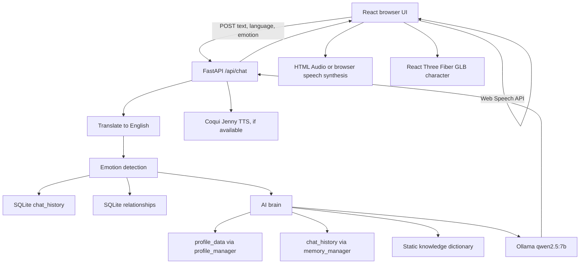

# Tanay

Tanay is an AI-powered emotional companion prototype with a FastAPI backend, a React/Three.js frontend, local SQLite persistence, multilingual text processing, emotion detection, Ollama conversation generation, and optional voice output. The repository contains two partially overlapping interaction paths: a web application in `backend/server.py` and a standalone microphone loop in `backend/main.py`.

## Problem Statement

Many digital assistants are optimized for short commands rather than meaningful, emotionally aware interaction. Tanay is intended to explore a more personal companion experience for people who feel emotionally isolated or want natural voice-based interaction, continuity, and a relationship that reflects repeated conversations. The current repository is an early prototype: several of these ideas are represented in code, while reliable long-term learning, secure deployment, and emotionally controlled character behavior remain unfinished.

## Our Solution

### Implemented in the current code

- React chat interface connected to a FastAPI API on `localhost:8000`.
- Browser Web Speech recognition for microphone input in supported browsers.
- Text chat through the `/api/chat` endpoint.
- Translation to English with `deep-translator` when the backend receives non-English text.
- Keyword and transformer-based emotion detection in the backend.
- Ollama chat generation using the configured model name, defaulting to `qwen2.5:7b`.
- SQLite chat history, relationship records, profiles, and manually managed memory records.
- Optional Coqui Jenny TTS output served from the backend and played by the browser.
- React Three Fiber/Three.js loading of `public/models/talking_main.glb`, with animation selection when the asset contains animations.
- A browser speech-synthesis fallback when backend audio is unavailable.
- Admin-oriented UI for settings, database viewing, analytics, and source-file editing.

### Planned or incomplete

- The web chat does not invoke the standalone profile extractor or the `profile_data` memory system.
- The frontend Memory Vault writes `memories`, but the AI brain retrieves `chat_history`, so Vault entries are not supplied to prompts.
- Backend emotion currently changes prompt text and frontend visual state, but TTS voice speed, facial expressions, and lip synchronization are not connected.
- Authentication is a demo-only hard-coded credential check and does not protect admin API requests.
- Continuous conversational streaming, production deployment, robust tests, and secure multi-user isolation are not implemented.

## Key Features

| Feature | Current status |
|---|---|
| Text chat | Implemented through FastAPI and React |
| Browser speech input | Implemented in supported Chromium browsers |
| Backend speech recording and Whisper transcription | Implemented in standalone `main.py` path |
| Translation | Implemented with an online Google translator backend |
| Emotion detection | Implemented with keyword and transformer paths |
| Ollama conversation | Implemented, requires a reachable Ollama service and model |
| SQLite chat history | Implemented |
| Profile and relationship data | Partially implemented; two disconnected schemas exist |
| Coqui Jenny TTS | Implemented, model-dependent |
| 3D GLB rendering | Implemented with Three.js fallback behavior |
| Facial expressions and lip sync | Not implemented |

## System Architecture



## Project Structure

```text
Tanay/
├── start_app.bat
├── README.md
├── backend/
│   ├── server.py                 # FastAPI web backend
│   ├── main.py                   # Standalone microphone conversation loop
│   ├── requirements.txt
│   ├── check_mic.py
│   ├── default_mic.py
│   ├── test_db.py
│   ├── test_jenny.py
│   ├── test_mic.py
│   ├── test_startup_import.py
│   ├── Audio/player.py
│   ├── brain/ai_brain.py
│   ├── brain/knowledge.py
│   ├── database/db_init.py
│   ├── database/tanay.db          # Local runtime data
│   ├── emotion/emotion_detector.py
│   ├── memory/*.py
│   ├── memory/memory.json
│   ├── speech/*.py
│   ├── tts/*.py
│   ├── datasets/speech_dataset/
│   ├── outputs/                   # Generated WAV files
│   ├── live.wav and response.wav  # Runtime audio files
│   └── __pycache__/               # Generated Python cache
└── frontend/
    ├── package.json
    ├── package-lock.json
    ├── index.html
    ├── start.js
    ├── vite.config.js
    ├── public/models/*.glb
    └── src/
        ├── main.jsx
        ├── App.jsx
        ├── components/*.jsx
        ├── pages/*.jsx
        └── utils/api.js
```

The working tree also contains a generated `frontend/dist` directory and duplicate GLB files at the frontend root and under `frontend/public/models`. These are build/output and asset-management concerns rather than separate application modules.

## How It Works

### Web path

1. The browser loads chat history, profile data, relationship data, and settings from FastAPI.
2. Text is entered manually or captured by the browser Web Speech API.
3. The frontend posts text, language, and the selected emotion mode to `/api/chat`.
4. The backend translates the text to English, detects emotion, retrieves recent `chat_history`, and reads the active relationship.
5. `brain.ai_brain.generate_response` builds a prompt containing relationship, days-known information, profile data, recent memories, keyword-matched chat history, static knowledge, emotion, and language, then calls Ollama.
6. The backend stores the exchange in `chat_history`, increments the web relationship record, and optionally generates a WAV file.
7. The browser plays the returned WAV or uses browser speech synthesis, and updates the GLB state or orb fallback.

### Standalone voice path

`backend/main.py` records 15 seconds through `sounddevice`, transcribes with Faster-Whisper using `task="translate"`, translates again as a backup, extracts profile facts, detects emotion, generates an Ollama reply, saves chat history, updates the legacy relationship table, generates Jenny audio, and plays it with Pygame. This path is separate from the FastAPI request path.

## Memory System

The repository has several storage layers:

- `chat_history` stores web and standalone conversation exchanges. The active AI brain retrieves recent rows and searches user-message text with SQL `LIKE`.
- `profile_data` stores key/value facts extracted by `profile_extractor.py`. The standalone loop updates it and the AI brain includes it in prompts.
- `user_profile` stores first-seen, last-seen, and standalone conversation count.
- `relationships` stores the web relationship level, score, and interaction count.
- `relationship` is a separate legacy table used by the standalone loop.
- `memories` stores manually entered frontend records, but the current AI brain does not retrieve this table.
- `learning_manager.py` is empty. No model retraining or Qwen fine-tuning code exists.

The current system therefore has persistence and prompt retrieval, but not one consistent long-term learning pipeline.

## AI Brain

`backend/brain/ai_brain.py` reads `database/settings.json` when present, otherwise uses `qwen2.5:7b`. It creates a system prompt with the base prompt, relationship level, days known, profile facts, recent chat history, keyword-matched history, static knowledge, current emotion, and requested language. It calls `ollama.chat`, limits the intended response to two sentences and 25 words in the prompt, strips several formatting phrases, and returns an emotion-based hard-coded fallback when Ollama fails.

The active web route passes relationship and recent chat history directly, while profile facts and keyword memory are read by the brain from the separate SQLite helpers. The route does not call `extract_profile`, so new web chat statements are not added to `profile_data`.

## Voice System

The standalone path uses `sounddevice` and `scipy` to record WAV audio, Faster-Whisper for transcription, and Pygame for playback. The web frontend uses browser Web Speech recognition for input. The backend can use Coqui TTS with `tts_models/en/jenny/jenny` to create WAV responses in `backend/outputs`; the frontend plays those files through an HTML `Audio` object. If backend TTS is unavailable or playback fails, it uses browser speech synthesis.

The voice profile and emotion profile modules exist, but `generate_voice.py` does not apply their speed or volume values. Emotion changes the selected response and frontend state rather than the actual synthesized voice.

## Emotion System

The active backend detector is `tts/emotion_detector.py`. It checks keywords first and otherwise calls `j-hartmann/emotion-english-distilroberta-base`. If loading fails, `server.py` installs a smaller keyword fallback. The separate `emotion/emotion_detector.py` is not imported by the active server or standalone loop. The frontend maps emotions to colors and GLB animation-name searches.

## 3D Character

`frontend/src/components/Avatar3D.jsx` renders React Three Fiber, loads `/models/talking_main.glb`, centers and scales it, and selects an animation by matching the requested state to animation names. If loading fails, it renders an animated procedural orb. The web response emotion drives the frontend state and lighting.

The model is not connected to phoneme timing, audio amplitude, facial blend-shapes, or backend animation events. The repository contains several large duplicate GLB files; the active URL is `frontend/public/models/talking_main.glb`.

## Technology Stack

- Python 3.11 was used by the checked virtual environment.
- FastAPI, Uvicorn, Pydantic, and Pandas.
- Ollama Python client with a default `qwen2.5:7b` model name.
- Faster-Whisper, SoundDevice, SciPy, NumPy, Deep Translator, and LangDetect.
- Transformers and PyTorch for emotion detection.
- Coqui TTS and Pygame for voice generation and standalone playback.
- SQLite.
- React 19, Vite, Tailwind CSS, Three.js, React Three Fiber, Drei, Recharts, and Lucide React.

## Installation

The repository has been tested with Python 3.11 and includes a local `.venv` in the current workspace. A fresh setup should use a Python 3.11 virtual environment, install `backend/requirements.txt`, install frontend packages from `frontend/package-lock.json`, and have Ollama available locally with the configured `qwen2.5:7b` model. The backend also downloads or loads Whisper, transformer, and Coqui model assets as required by the installed libraries.

```powershell
py -3.11 -m venv .venv
.\.venv\Scripts\Activate.ps1
pip install -r requirements.txt
Set-Location frontend
npm install
Set-Location ..
```

No `.env` file or environment-variable configuration is currently used by the application. Translation uses the online Google translator service through `deep-translator`. Microphone use requires an available system input device. The repository does not declare a separate FFmpeg dependency; verify the audio/model requirements of the installed Faster-Whisper and TTS versions on the target machine.

## Running Tanay

The repository launcher starts both processes:

```powershell
.\start_app.bat
```

It opens the backend on `http://localhost:8000` and the Vite frontend on `http://localhost:5173`. The equivalent direct commands are:

```powershell
Set-Location backend
..\.venv\Scripts\python.exe server.py

Set-Location ..\frontend
npm run dev
```

The frontend API URL is hard-coded to `http://localhost:8000` in `frontend/src/utils/api.js`.

## Current Development Status

| Component | Status |
|---|---|
| FastAPI web chat | Working with local dependencies and services |
| Ollama/Qwen integration | Implemented; external Ollama/model required |
| Browser text input | Working |
| Browser speech input | Partial; browser support and permissions required |
| Standalone microphone/STT loop | Implemented but separate from web UI |
| Translation | Partial; online service and language behavior constraints |
| Emotion detection | Working when model/cache loads; keyword fallback exists |
| Chat history | Working in SQLite |
| Profile learning | Partial; standalone-only extraction |
| Long-term memory | Partial and split across incompatible tables |
| Relationship system | Partial; duplicate web and legacy implementations |
| TTS | Partial; model load and English Jenny voice dependent |
| Audio playback | Working in standalone and browser paths |
| React frontend | Builds successfully |
| Frontend lint | Blocked by an installed Babel dependency error |
| 3D GLB rendering | Partial; model/animation loading exists |
| Facial expressions | Not implemented |
| Lip synchronization | Not implemented |
| Continuous conversation | Not implemented |
| Offline capability | Partial; Ollama/TTS/model caches can be local, translation is online |
| Cloud capability | Not implemented |
| Automated testing | Minimal; pytest is not installed and hardware/model tests are environment-dependent |
| Security | Not ready for deployment |

## Roadmap

1. Unify web and standalone memory, profile, and relationship paths.
2. Connect profile extraction and durable fact retrieval to web chat.
3. Decide whether the `memories` table stores facts or conversation history, then make the brain retrieve it consistently.
4. Replace demo admin credentials with real authentication, authorization, password hashing, and token validation.
5. Add multi-user isolation, request validation, rate limiting, and secure CORS/deployment configuration.
6. Connect emotion to actual voice settings and character animation behavior.
7. Add facial expression, phoneme/lip-sync, and audio-driven animation support.
8. Add focused unit tests, API tests, dependency lock/version policy, and hardware-independent test doubles.
9. Reduce startup cost by making heavy model loading explicit or lazy and document model/system prerequisites.
10. Remove or deduplicate generated assets and define a release/deployment strategy for large GLB and model files.

## Limitations

- Admin APIs are reachable without checking the token saved by the frontend; the hard-coded `admin` / `admin123` credential is not secure.
- API base URLs, user IDs, and relationship records are hard-coded for local development.
- The web route may generate many persistent WAV files in `backend/outputs`.
- The database contains local user/profile/chat data and should be treated as private.
- Translation is not offline, while model loading can require downloads and significant memory.
- The frontend and backend use different profile and memory concepts.
- The project has no root `.gitignore`, license, CI configuration, or production configuration.

## Future Vision

The long-term direction is a privacy-conscious companion with one reliable memory model, natural multilingual voice conversation, emotion-aware responses, and a 3D character whose expressions and mouth movement follow the conversation. Those capabilities require the architecture, security, persistence, and testing work listed in the roadmap; they are not complete in the current repository.

## GitHub Readiness

The project is **not ready for a first public GitHub commit** without cleanup and review.

### Candidate source to commit

Commit source files, `backend/requirements.txt`, frontend source/configuration, `frontend/package-lock.json`, the launcher, and this README after reviewing the large model assets and dataset licensing.

### Ignore

At minimum, ignore:

```gitignore
.venv/
__pycache__/
*.py[cod]
.pytest_cache/
frontend/node_modules/
frontend/dist/
*.log
*.local
.env
.env.*
backend/database/*.db
backend/database/*.sqlite*
backend/outputs/
backend/live.wav
backend/response.wav
backend/Audio/live.wav
backend/*.wav
backend/datasets/**/audio/
*.pt
*.pth
*.bin
```

### Do not push without review

Do not push `backend/database/tanay.db`, `backend/memory/memory.json`, chat/audio outputs, `live.wav`, `response.wav`, Python caches, `frontend/dist`, `.venv`, or any downloaded model cache. The database currently contains hundreds of chat rows and profile data. Review whether the speech dataset and all GLB assets may legally be redistributed; the repository has no license file or asset provenance documentation.

The backend also contains a hard-coded demo password and token. They are not external secrets, but they must be removed or replaced before any public deployment.

## Contributors

Contributions are welcome after the project’s architecture, persistence model, and security boundary are consolidated. Please document new model, audio, or 3D assets and add tests for new backend behavior.

## License

No license is currently present. Choose and add an appropriate license after confirming ownership and redistribution rights for the code, datasets, voices, and GLB assets.

## Recommended First Commit

```text
feat: initialize Tanay AI companion core
```
